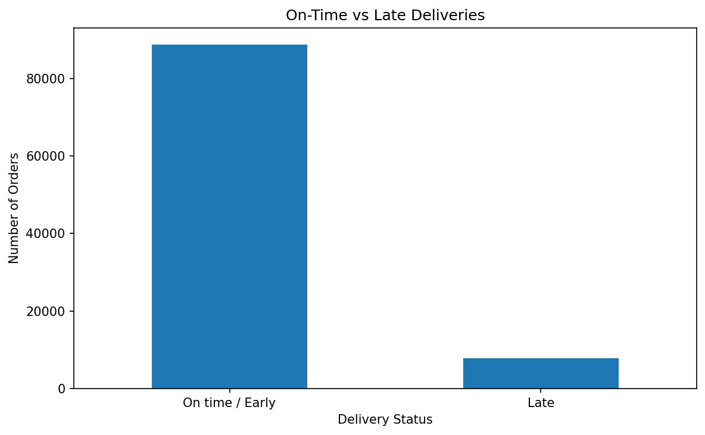
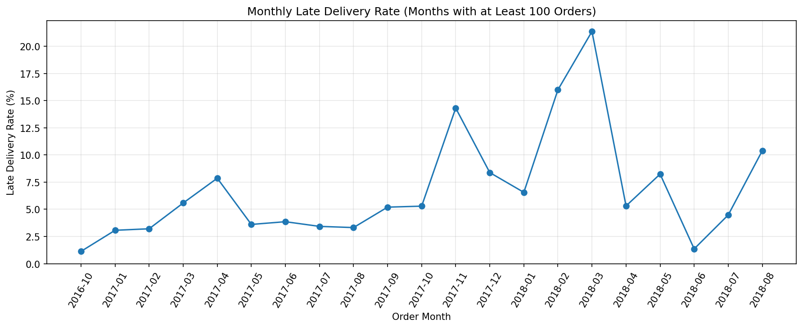
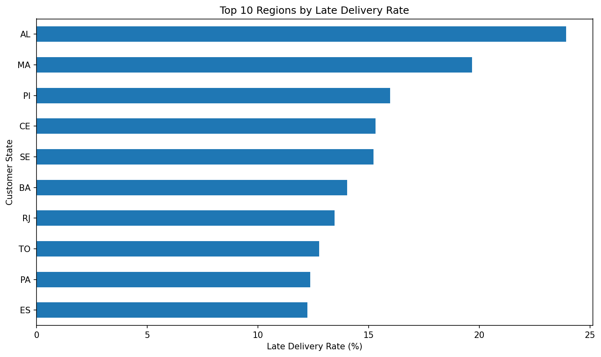

# Delivery Performance Analytics

## Project Overview

This project analyzes e-commerce delivery performance using the Brazilian E-Commerce Public Dataset by Olist. The analysis focuses on delivery duration, late delivery rates, monthly trends, and regional performance.

The goal is to identify delivery performance patterns and present data-driven findings that can support operational decision-making.

## Business Questions

- What percentage of orders arrive later than their estimated delivery dates?
- How long does delivery take on average?
- How does the late delivery rate change over time?
- Which customer states have higher late delivery rates?

## Dataset

**Source:** [Brazilian E-Commerce Public Dataset by Olist — Kaggle](https://www.kaggle.com/datasets/olistbr/brazilian-ecommerce)

The analysis uses the following datasets:

- `olist_orders_dataset.csv`
- `olist_customers_dataset.csv`

The original dataset is not included in this repository. Download it from Kaggle and place the required CSV files in the `data/` directory.

## Tools and Technologies

- Python
- Pandas
- Matplotlib
- Jupyter Notebook
- VS Code

## Methodology

1. Load the order and customer datasets.
2. Inspect data types, missing values, and order statuses.
3. Convert delivery-related columns to datetime format.
4. Select delivered orders with valid purchase, actual delivery, and estimated delivery dates.
5. Calculate delivery duration and delivery delay.
6. Calculate monthly and regional late delivery rates.
7. Visualize delivery performance and export summary tables.

### Metric Definitions

- **Delivery duration:** Time between purchase and actual customer delivery, measured in days.
- **Late delivery:** An order is considered late when its actual delivery date is later than its estimated delivery date.
- **Late delivery rate:** Number of late orders divided by the number of valid delivered orders in the group, multiplied by 100.

## Key Findings

- March 2018 recorded a late delivery rate of **21.36%**, with 1,496 late orders out of 7,003 valid deliveries in the analysis.
- September 2016 had only one valid order, which was late. Its 100% late delivery rate is therefore not representative of a month with substantial order volume.
- The regional results are available in the exported analysis table and should be interpreted alongside the number of orders in each region.

These findings describe the analyzed dataset and do not establish the causes of delivery delays.

## Visualizations

### On-Time vs. Late Deliveries



### Monthly Late Delivery Rate



The monthly chart excludes months with fewer than 100 valid orders to make the main comparison less sensitive to very small monthly samples. The original monthly results remain available in the exported CSV.

### Regional Late Delivery Rate



Regional rates should be interpreted alongside order volume. A high percentage in a region with few orders may be less stable than a similar percentage based on many orders.

## Project Structure

```text
Delivery-Performance-Analytics/
├── data/
├── notebooks/
│   └── 01_delivery_performance_analysis.ipynb
├── reports/
│   ├── figures/
│   ├── monthly_performance.csv
│   └── regional_performance.csv
├── .gitignore
├── README.md
└── requirements.txt
```

## How to Run

1. Clone or download this repository.
2. Create and activate a Python virtual environment.
3. Install the required libraries:

   ```bash
   pip install -r requirements.txt
   ```

4. Download the Olist dataset from Kaggle.
5. Place the required CSV files in the `data/` directory.
6. Open `notebooks/01_delivery_performance_analysis.ipynb` in VS Code.
7. Select the project Python environment and run the notebook cells in order.

## Limitations

- The results depend on the completeness and quality of the source dataset.
- The analysis measures observed delivery delays but does not establish their causes.
- Regional comparisons may be affected by differences in order volume.
- The monthly chart uses a minimum order-count threshold for its main visualization.

## Future Improvements

- Add SQL queries for data validation and aggregation.
- Build an interactive dashboard.
- Investigate factors associated with delivery delays.
- Add automated data quality checks and a reproducible analysis pipeline.
